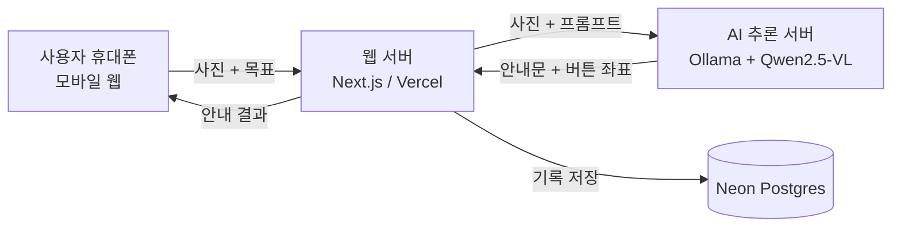

# 키오스크 길잡이

**어떤 키오스크든 카메라로 비추면 음성으로 주문을 도와주는 AI 서비스**

인공지능서비스개발II 팀 프로젝트 기획서 · 2026. 00. 00.

| 팀명 | 팀장 | 팀원 |
|---|---|---|
| NODEAR | 학번 / 이름 | 학번 / 이름 |

---

## 요약

### 서비스 개요

휴대폰 카메라로 키오스크 화면을 비추면, AI가 **눌러야 할 버튼을 화면에 표시**하고 **음성으로 안내**하는 모바일 웹 서비스

### 개발 배경

- 키오스크마다 화면 구성이 다르고 단계가 많아 고령자·저시력자가 주문에 어려움을 겪음
- 배리어프리 키오스크는 기기 교체가 필요하고, 연습 앱은 실제 매장 화면과 다름
- → 키오스크를 바꾸지 않고 **사용자의 휴대폰만으로** 해결

### 사용 흐름

① 원하는 주문을 말로 입력 → ② 키오스크 화면 촬영 → ③ AI가 눌러야 할 버튼을 표시하고 음성 안내 → ④ 주문 완료까지 반복

### 핵심 기술

- **비전-언어 모델(Qwen2.5-VL)**: 처음 보는 키오스크 화면에서 버튼 위치를 찾음
- **음성 인식·합성(STT/TTS)**: 말로 묻고 말로 안내
- **단계적 개발**: 프롬프트로 먼저 구현 → 정확도가 부족하면 LoRA 파인튜닝

### 결과물 및 평가

- Next.js 모바일 웹으로 개발해 Vercel에 배포
- 학습 없이 프롬프트만으로 동작하는 것이 기본
- 직접 수집한 키오스크 화면 200장 이상을 **평가용**으로 사용해 버튼 안내 정확도, 주문 완료율, 응답 시간 측정

---

## 1. 개발 배경 및 필요성

### 1.1 배경

- 음식점, 카페, 영화관, 병원 등에서 주문과 접수가 빠르게 키오스크로 바뀌고 있음
- 키오스크는 매장마다 화면 구성이 다르고, 글씨가 작고, 단계가 많음
- 고령자, 저시력 사용자는 주문을 포기하거나 다른 사람의 도움을 받아야 함 → **디지털 격차**
- *(키오스크 이용 어려움 관련 통계와 출처 추가 예정)*

### 1.2 기존 해결책의 한계

| 기존 해결책 | 한계 |
|---|---|
| 배리어프리 키오스크 | 기기를 교체해야 하므로 이미 설치된 키오스크에는 적용이 어려움 |
| 키오스크 교육·연습 앱 | 가상 화면으로 연습하므로 실제 매장의 다른 화면에는 그대로 적용되지 않음 |
| 직원 도움 | 무인 매장이나 바쁜 시간에는 도움을 받기 어려움 |

### 1.3 차별점

- 키오스크가 아니라 **사용자의 휴대폰 쪽에서** 문제를 해결하므로 기존 키오스크에 바로 적용 가능
- 미리 등록된 화면이 아니라 **처음 보는 키오스크 화면**도 AI가 읽고 판단
- 안내 문구를 미리 코딩하는 방식으로는 불가능한 기능이므로 **AI가 꼭 필요함**

---

## 2. 개발 목표

### 2.1 목표

- 실제 매장의 키오스크 사진에서 사용자의 목표를 이루기 위해 **다음에 눌러야 할 버튼을 찾아 안내**
- 눌러야 할 버튼을 촬영 사진 위에 **빨간 상자로 표시**
- 말로 묻고 말로 듣는 **음성 대화** 지원
- 직접 구축한 데이터셋으로 **안내 정확도를 수치로 측정**하고 개선
- 앱 설치 없이 링크로 쓰는 **모바일 웹으로 배포**

### 2.2 주요 타겟

| 대상 | 어려움 | 지원 방법 |
|---|---|---|
| 고령자 | 작은 글씨, 복잡한 단계 | 큰 글씨, 느린 음성, 한 번에 한 단계씩 안내 |
| 저시력 사용자 | 화면 글자를 읽기 어려움 | 음성 중심 안내, 버튼 위치를 방향("오른쪽 아래")으로 설명 |

---

## 3. 벤치마킹(또는 관련 연구)

| 서비스·연구 | 설명 | 공통점 | 차별점 |
|---|---|---|---|
| Be My Eyes (Be My AI) | 사진을 찍으면 AI가 내용을 설명하는 시각장애인 지원 앱 | 카메라와 비전 AI로 시각 정보 전달 | 범용 설명이 목적이라 주문 완료까지 단계별로 이끌지 않음 |
| Seeing AI, Lookout | 카메라로 글자와 사물을 읽어 주는 접근성 앱 | 화면 글자를 읽어 줌 | 무엇을 눌러야 하는지는 판단하지 않음 |
| 키오스크 교육·연습 앱 | 가상 키오스크로 주문 과정을 연습 | 키오스크 사용법 학습 지원 | 연습 화면과 실제 화면이 다름. 본 서비스는 실제 키오스크 앞에서 사용 |
| 배리어프리 키오스크 | 높이 조절, 음성 안내 등을 갖춘 키오스크 | 키오스크 접근성 향상 | 기기 교체 필요. 본 서비스는 기존 키오스크에 그대로 적용 |
| 비전-언어 모델의 GUI 이해 연구 | 화면 이미지에서 UI 요소 위치를 찾는 연구 | 화면 이해 기술의 기반 | 실제 촬영 사진(기울기, 반사, 흐림) 환경에 적용하고 평가 |

*(각 서비스와 연구의 출처 링크 추가 예정)*

---

## 4. 예상 결과물 UI

모바일 웹(세로 화면) 기준. Wireframe 그림은 Figma로 제작해 첨부.

| 화면 | 그림 설명 |
|---|---|
| ① 목표 입력 | "무엇을 주문하고 싶으세요?" 질문, 큰 마이크 버튼, 인식된 문장 표시(수정 가능), 글씨 크기 조절 |
| ② 키오스크 촬영 | 카메라 미리보기와 촬영 가이드 테두리, "키오스크 화면이 테두리 안에 들어오게 비춰 주세요" 음성 안내 |
| ③ 안내 | 촬영 사진 위에 눌러야 할 버튼을 빨간 상자로 표시, 아래에 안내 문구와 음성 재생, [다시 듣기] [눌렀어요, 다음] [다시 찍기] 버튼 |
| ④ 완료 | 지금까지 누른 단계 표시, "주문이 끝났어요" 안내, [처음으로] 버튼 |

---

## 5. 주요 기능

| 주요 기능 | 세부 설명 |
|---|---|
| 화면 인식 | 촬영한 키오스크 사진에서 현재 단계(메뉴 선택, 옵션, 장바구니, 결제)와 버튼을 파악 |
| 다음 행동 안내 | 목표와 진행 상황을 바탕으로 지금 눌러야 할 버튼 하나를 고르고, 위치와 이름을 쉬운 말로 안내 |
| 버튼 위치 표시 | 모델이 출력한 버튼 좌표로 촬영 사진 위에 빨간 상자와 "여기를 누르세요" 표시 |
| 음성 대화 | 목표를 말로 입력(STT)하고 안내를 음성으로 출력(TTS), 말하는 속도 조절 |
| 단계별 진행 | 누른 버튼을 기억하고, 바뀐 화면을 다시 찍게 해 주문 완료까지 이어서 안내 |
| 기록 및 피드백 | 안내 결과와 사용자 피드백("맞았어요/틀렸어요")을 저장해 성능 평가에 활용(사용자 동의 후 저장) |

---

## 6. 시스템 구조(Architecture)



| 구성요소 | 설명 | 개발 환경 및 구현 방법 |
|---|---|---|
| Frontend (모바일 웹) | 카메라 촬영, 음성 입출력, 안내 문구와 버튼 위치 표시 | Next.js, TypeScript, Tailwind CSS / 카메라는 브라우저 `getUserMedia`, 음성은 Web Speech API |
| 웹 서버 (API) | 사진과 목표로 프롬프트를 만들어 AI 서버에 요청, 응답 형식과 좌표 검증, 진행 단계와 기록 관리 | Next.js Route Handler, Vercel 배포 |
| AI 추론 서버 | 사진과 목표를 받아 다음 버튼의 이름, 위치 설명, 좌표를 JSON으로 출력 | Ollama에서 Qwen2.5-VL(7B, 사양에 따라 3B) 실행, Cloudflare Tunnel로 웹 서버와 연결 |
| DB | 안내 기록, 사용자 피드백, 평가 데이터 관리 | Neon Postgres |
| 학습 환경(선택) | 정확도가 부족할 때 키오스크 데이터로 파인튜닝 | LLaMA-Factory 또는 ms-swift, Colab 또는 학교 GPU |

---

## 7. 개발 방법론

### 7.1 모델 선택

- 일반 Qwen은 텍스트만 이해하므로, 화면 사진을 이해하는 **비전-언어 모델 Qwen2.5-VL** 사용
- 이미지 속 UI 요소의 위치를 좌표로 출력할 수 있어 버튼 위치 표시에 적합
- 공개 모델이라 로컬에서 직접 실행 가능 → 호출당 과금 없음
- 7B 모델을 기본으로 하고, GPU 메모리가 부족하면 3B 모델 사용

### 7.2 단계적 개발

| 단계 | 방법 | 내용 |
|---|---|---|
| 1단계 | 프롬프트 (학습 없음) | 사진, 목표, 출력 형식(JSON)을 주는 프롬프트를 설계해 전체 흐름을 먼저 완성 |
| 2단계 | 프롬프트 개선 | 화면 단계 판단 → 버튼 선택의 2단계 질의, 예시를 넣은 few-shot, 이미지 보정(회전, 밝기) |
| 3단계 | LoRA 파인튜닝 (필요 시) | 1·2단계 정확도가 부족하면 수집 데이터로 학습하고 전후 성능 비교 |

### 7.3 출력 형식

```json
{
  "화면단계": "메뉴 선택",
  "다음버튼": "커피",
  "위치설명": "화면 왼쪽 위 두 번째 탭",
  "좌표": [120, 80, 260, 140],
  "안내문": "왼쪽 위의 '커피' 탭을 누르세요."
}
```

- 웹 서버가 형식과 좌표 범위를 검증하고, 실패하면 "다시 찍어 주세요"로 안내

### 7.4 데이터

- **용도**: 기본 방식(1·2단계)은 학습을 하지 않으므로, 수집한 데이터는 **성능 평가용**으로 사용
  - 정답이 붙은 사진에서 AI가 고른 버튼과 정답을 비교해 정확도 측정
  - 3단계 파인튜닝을 할 경우에만 일부를 **학습용**으로 추가 사용
- **수집**: 학교 주변 카페, 패스트푸드점, 영화관 등 매장 10곳 이상에서 키오스크 화면 200장 이상 촬영
- **라벨링**: 사진마다 목표와 정답 버튼(이름, 좌표) 표시, 한 사진에 여러 목표를 붙여 평가 문항 확대(Label Studio 등 사용)
- **분할(파인튜닝 시)**: 매장 단위로 학습용과 평가용을 나눠, 학습에 쓰지 않은 매장으로 **처음 보는 키오스크** 성능 확인
- **개인정보**: 사람 얼굴과 결제 정보가 찍히지 않게 촬영, 필요하면 매장 허락

### 7.5 평가 지표

| 지표 | 정의 |
|---|---|
| 버튼 안내 정확도 | 모델이 고른 버튼이 정답과 같은 비율 |
| 위치 정확도 | 표시한 상자의 중심이 정답 버튼 안에 있는 비율 |
| 주문 완료율 | 실제 사용 테스트에서 안내만 따라 주문을 끝낸 비율 |
| 응답 시간 | 촬영부터 안내까지 걸린 시간 (목표 5초 이내) |

- 모델 크기별(7B, 3B)과 개선 전후(프롬프트 → 파인튜닝) 결과 비교

### 7.6 실행 환경과 비용

| 실행 방식 | 비용 | 활용 |
|---|---|---|
| 로컬 실행 (Ollama) | 추가 요금 없음 (장비, 전기 비용) | 개발과 시연의 기본 방식 |
| 클라우드 API | 호출할 때마다 토큰 단위 과금 | 로컬 서버를 쓸 수 없을 때의 대체 수단 |
| 클라우드 GPU | 대부분 유료 | 파인튜닝이 필요할 때만 사용 |

- 웹 서버는 Vercel, AI 서버는 팀원 PC의 Ollama를 Cloudflare Tunnel로 연결

---

## 8. 팀원 역할분담(R&R)

- 2인 팀이므로 **AI 담당**과 **웹 서비스 담당**으로 나눔
- 두 사람이 만나는 지점은 웹 서버와 AI 서버 사이의 요청·응답 형식 → 먼저 확정하고 각자 개발

| 팀원 | 역할 및 할 일 |
|---|---|
| (이름) 팀장 · AI 담당 | Ollama와 Qwen2.5-VL 서버 구축, Tunnel 연결<br/>프롬프트 설계와 개선<br/>평가 스크립트 작성, 정확도 측정, 모델 크기 비교<br/>(선택) LoRA 파인튜닝<br/>일정 관리, 발표 자료 총괄 |
| (이름) 팀원 · 웹 서비스 담당 | 카메라 촬영, 음성 입출력, 버튼 위치 표시 화면<br/>웹 서버 API, DB 연동<br/>Vercel 배포, 휴대폰 실기기 테스트<br/>사용성 테스트, 주문 완료율 측정<br/>구조도, Wireframe, 보고서 정리 |
| 공동 | 평가용 키오스크 사진 수집(각자 매장 5곳 이상), 라벨링과 교차 검토, 시연과 최종 발표 |

---

## 9. 일정(소요예산, 요청사항 포함)

### 9.1 일정

| 기간 | AI 담당 (팀장) | 웹 서비스 담당 (팀원) | 프로토타입 기능 |
|---|---|---|---|
| ~ 7주 | Qwen2.5-VL로 키오스크 사진 안내 가능성 확인 | 화면 흐름 구성, 요청·응답 형식 확정 | - |
| **Sprint 1 (8주)** | 프롬프트 1차 완성, AI 서버 연결 | 사진 업로드 → 안내 출력, Vercel 배포 | 사진을 올리면 눌러야 할 버튼을 문구로 안내 |
| 9 ~ 11주 | 평가 데이터 라벨링, 평가 스크립트 작성 | 카메라 촬영, 버튼 위치 표시, 음성 입출력, 단계별 진행 | - |
| **Sprint 2 (12주)** | 정확도 1차 측정 | 음성만으로 주문 전 과정 안내 | 말로 묻고, 버튼 표시와 음성 안내를 받으며 주문 완료 |
| 13 ~ 14주 | 프롬프트 개선 또는 파인튜닝, 모델 비교 | 고령자 사용성 테스트, 오류 처리 | - |
| **Sprint 3 (15주)** | 개선 전후 성능 비교 정리 | 최종 배포, 매장 시연 영상 | 최종 서비스와 성능 비교 결과 |

### 9.2 범위 조절

- 2인 팀이므로 일정이 밀리면 아래의 뒤쪽 항목부터 줄임
  - **필수**: 버튼 안내(문구 + 위치 표시), 음성 입출력, 배포, 정확도 평가
  - **권장**: 단계별 진행, 피드백 저장, 사용성 테스트
  - **선택**: LoRA 파인튜닝

### 9.3 소요 예산 및 요청사항

- **예산**: 최소화
  - 모델은 로컬에서 실행하고, Vercel·Neon·Cloudflare Tunnel은 무료 플랜 우선 사용
  - GPU나 API 비용은 로컬 실행이 어렵거나 파인튜닝이 필요할 때만 사용
- **요청사항** (교수자와 사전 상의)
  - 파인튜닝과 시연용 GPU 환경(학교 GPU 서버 또는 Colab Pro)
  - 로컬 서버를 쓸 수 없을 때를 대비한 비전 모델 API 크레딧

---

## 10. 기대 효과 및 활용 분야

### 10.1 기대 효과

- 디지털 취약계층이 다른 사람의 도움 없이 혼자 키오스크로 주문
- 키오스크를 교체하지 않고 사용자의 휴대폰만으로 접근성 향상
- 반복 사용을 통해 키오스크 사용법 자체를 익히는 학습 효과

### 10.2 활용 분야

- 병원 접수기, 무인 민원발급기, 공항 셀프 체크인 등 **터치스크린 무인기기 전반**으로 확장
- 노인복지관, 디지털배움터의 키오스크 교육 보조 도구
- 수집한 키오스크 화면 데이터셋을 접근성 연구에 활용

---

## [별첨] 위험요소와 대응 방안

| 위험요소 | 대응 방안 |
|---|---|
| 사진의 반사, 기울기, 흐림으로 인식 실패 | 촬영 가이드 테두리, 이미지 보정, "조금 더 가까이 찍어 주세요" 안내 |
| 모델이 틀린 버튼을 안내 | 확신이 낮으면 다시 촬영 요청, 결제 단계에서는 "금액을 확인하세요" 주의 문구 |
| 응답이 느림 | 3B 모델 비교, 사진 크기 축소, 기다리는 동안 음성 안내 |
| 시연 때 AI 서버가 꺼져 있음 | 시연 전 점검 체크리스트, API 대체 경로 준비 |
| 촬영 사진의 개인정보 | 저장 시 동의, 평가용으로만 사용, 얼굴이 찍힌 사진 제외 |
| "챗봇 하나 붙인 것"으로 보일 위험 | 처음 보는 키오스크 인식, 버튼 위치 표시, 정량 평가로 AI의 역할을 분명히 함 |

### 외부 자원 출처

- Qwen2.5-VL (Alibaba Qwen 팀, 공개 모델)
- Ollama, LLaMA-Factory, ms-swift, Label Studio (오픈소스)
- Next.js, Tailwind CSS, Neon, Vercel, Cloudflare Tunnel
- *(통계와 벤치마킹 서비스의 출처 링크 추가 예정)*
