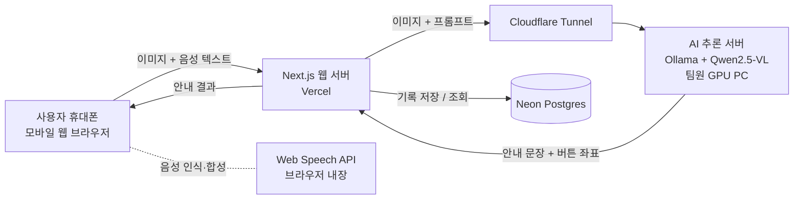

# (프로젝트명) 키오스크 길잡이 — 카메라로 비추면 음성으로 주문을 도와주는 AI

인공지능서비스개발II 팀 프로젝트 기획서

2026. 00. 00.

| 팀명 | NODEAR |
|---|---|
| 팀장 | 학번 / 이름 |
| 팀원 | 학번 / 이름 |

---

## 요약

### 한 줄 소개

**"어떤 키오스크든 휴대폰 카메라로 비추면, AI가 눌러야 할 버튼을 화면에 표시하고 음성으로 안내해 주는 모바일 웹 서비스"**

### 배경 및 문제

음식점, 카페, 영화관, 병원 등에서 주문과 접수가 빠르게 키오스크로 바뀌고 있다. 그러나 매장마다 화면 구성이 다르고, 글씨가 작고, 거쳐야 할 단계가 많다. 그래서 고령자, 저시력 사용자, 한국어가 서툰 외국인은 주문을 포기하거나 다른 사람의 도움을 받아야 한다. 이는 대표적인 디지털 격차 문제이다. 기존 해결책에는 한계가 있다. 배리어프리 키오스크는 기기를 교체해야 하고, 키오스크 연습 앱은 실제 매장 화면과 다르다. 무인 매장이나 바쁜 시간에는 직원의 도움을 받기도 어렵다.

### 해결 방법

사용자가 "아이스 아메리카노 한 잔 포장"처럼 **원하는 주문을 말로 입력**하고 키오스크 화면을 휴대폰으로 찍는다. 그러면 비전-언어 모델이 **처음 보는 화면이라도 읽고, 목표를 이루기 위해 지금 눌러야 할 버튼 하나**를 고른다. 서비스는 찍은 사진 위에 그 버튼을 **빨간 상자로 표시**하고, "오른쪽 아래 '커피' 버튼을 누르세요"라고 **음성으로 안내**한다. 사용자가 버튼을 누르고 바뀐 화면을 다시 찍으면 다음 단계를 안내하며, 이 과정을 주문이 끝날 때까지 반복한다. 키오스크를 바꾸지 않고 **사용자의 휴대폰만으로** 문제를 해결하는 것이 핵심이다.

### 주요 타겟

고령자(큰 글씨, 느린 음성, 한 번에 한 단계씩 안내), 저시력 사용자(음성 중심, 방향으로 위치 설명), 외국인(영어 안내)

### 주요 기능

| 기능 | 내용 |
|---|---|
| 키오스크 화면 인식 | 찍은 사진에서 현재 단계(메뉴 선택, 옵션, 결제 등)와 버튼 파악 |
| 다음 행동 안내 | 목표와 진행 상황을 바탕으로 지금 눌러야 할 버튼 하나를 쉬운 말로 안내 |
| 버튼 위치 표시 | 모델이 출력한 좌표로 사진 위에 눌러야 할 곳을 빨간 상자로 강조 |
| 음성 대화 | 목표를 말로 입력(STT)하고 안내를 음성으로 들려줌(TTS) |
| 단계별 진행 | 누른 버튼을 기억하며 주문 완료까지 이어서 안내 |
| 기록 및 평가 | 안내 결과와 사용자 피드백을 저장해 성능 평가에 활용 |

### AI 기술과 차별점

비전-언어 모델 **Qwen2.5-VL**은 이미지 속 UI 요소의 위치를 좌표로 찾을 수 있다. 미리 등록된 화면만 안내하는 규칙 기반 방식과 달리 **실제 매장의 처음 보는 키오스크**에서도 동작한다. 그래서 이 서비스에는 AI가 꼭 필요하다. 개발은 ① 프롬프트만으로 동작 → ② few-shot과 이미지 보정으로 개선 → ③ 정확도가 부족하면 직접 수집한 데이터로 **LoRA 파인튜닝**하는 단계로 진행한다.

### 시스템 구성 및 기술 스택

- **웹**: Next.js, TypeScript, Tailwind CSS로 모바일 웹을 만들어 Vercel에 배포한다. 앱을 설치하지 않고 링크만으로 쓸 수 있다.
- **음성**: 브라우저에 내장된 Web Speech API를 쓴다.
- **AI 서버**: Ollama로 Qwen2.5-VL(7B/3B)을 로컬 GPU에서 실행하고 Cloudflare Tunnel로 연결한다.
- **DB**: Neon Postgres
- **운영 비용**: 무료 플랜과 로컬 실행으로 **0원**을 목표로 한다.

### 성능 평가

팀원이 매장 10곳 이상에서 키오스크 화면을 200장 이상 촬영하고, 사진마다 정답 버튼을 라벨링해 평가 데이터셋을 만든다. 학습에 쓰지 않은 매장의 사진으로 다음 지표를 측정하고, 모델 크기별(7B, 3B)·개선 전후로 비교한다.
- **버튼 안내 정확도**: 올바른 버튼을 고른 비율
- **위치 정확도**: 표시한 상자가 실제 버튼 위에 있는 비율
- **주문 완료율**: 실제 사용 테스트에서 안내만 따라 주문을 끝낸 비율
- **응답 시간**: 목표 5초 이내

### 일정 및 역할

- **일정**: Sprint 1(8주)에 사진 → 안내 문구 흐름과 배포를 완성한다. Sprint 2(12주)에 음성 안내 전 과정과 1차 정확도 측정을 마친다. Sprint 3(15주)에 성능 개선, 사용성 테스트, 실제 매장 시연을 진행한다.
- **역할**: 2인 팀으로, 팀장이 AI(모델 서버, 프롬프트, 평가, 파인튜닝)를, 팀원이 웹 서비스(화면, 음성, API, DB, 배포, 사용성 테스트)를 맡는다. 데이터 수집과 라벨링은 함께 한다.

### 기대 효과

- 디지털 취약계층이 다른 사람의 도움 없이 혼자 키오스크로 주문할 수 있다.
- 기존 키오스크를 그대로 둔 채 접근성을 높인다.
- 병원 접수기, 무인 민원발급기, 공항 셀프 체크인 등 **모든 터치스크린 무인기기**로 확장할 수 있다.

---

## 1. 개발 배경 및 필요성

### 배경

음식점, 카페, 영화관, 병원 등에서 키오스크가 빠르게 늘면서 주문과 접수의 상당 부분이 키오스크로 넘어갔다. 그러나 화면 구성이 매장마다 다르고, 글씨가 작고, 단계가 많아 고령자·시각장애인·한국어가 서툰 외국인은 주문 자체를 포기하거나 뒷사람 눈치를 보며 도움을 요청해야 한다. 이는 대표적인 **디지털 격차** 문제이다. *(키오스크 이용 어려움 관련 통계 및 출처 추가 예정)*

### 기존 해결책의 한계

- **배리어프리 키오스크**: 키오스크 자체를 바꿔야 하므로 이미 설치된 기기에는 적용이 어렵고, 교체에 시간과 비용이 든다.
- **키오스크 교육 및 연습 앱**: 미리 만들어 둔 가상 화면으로 연습하는 방식이라 실제 매장의 다른 화면 구성에는 그대로 적용되지 않는다.
- **직원 도움**: 무인 매장이나 바쁜 시간에는 도움을 받기 어렵다.

### 차별점

이 서비스는 **키오스크를 바꾸지 않고 사용자의 휴대폰 쪽에서** 문제를 해결한다. 비전-언어 모델이 처음 보는 화면도 읽고 판단하므로 매장별로 미리 등록할 필요가 없다. 이 부분은 규칙 기반 코딩으로는 해결할 수 없어 **AI가 꼭 필요한 이유**가 된다.

---

## 2. 개발 목표

### 해결하려는 문제

"처음 보는 키오스크 앞에서 무엇을 눌러야 할지 모르는 상황"을 AI 안내로 해결한다.

### 세부 목표

1. 카메라로 찍은 실제 키오스크 화면에서 사용자의 목표(예: 아이스 아메리카노 주문)를 이루기 위한 **다음 버튼을 찾아 안내**한다.
2. 말로 묻고 말로 듣는 **음성 대화**를 지원한다. 글을 읽기 어려운 사용자도 쓸 수 있게 한다.
3. 안내한 버튼의 위치를 촬영된 이미지 위에 **강조 표시**한다.
4. 직접 구축한 평가 데이터셋으로 **안내 정확도를 수치로 측정**하고 개선한다.
5. 모바일 웹으로 **배포**해 앱 설치 없이 링크만으로 쓸 수 있게 한다.

### 주요 타겟

| 대상 | 상황 | 필요한 지원 |
|---|---|---|
| 고령자 | 작은 글씨와 복잡한 단계에 익숙하지 않음 | 큰 글씨, 느린 음성, 한 번에 한 단계씩 안내 |
| 저시력 사용자 | 화면 글자를 읽기 어려움 | 음성 중심 안내, 버튼 위치를 방향("오른쪽 아래")으로 설명 |
| 외국인 | 한국어 메뉴와 버튼을 읽기 어려움 | 모국어(영어 등) 질문과 답변 |

---

## 3. 벤치마킹(또는 관련 연구)

| 서비스 및 연구 | 설명 | 공통점 | 차별점(개선점) |
|---|---|---|---|
| Be My Eyes (Be My AI) | 시각장애인이 사진을 찍으면 AI가 내용을 설명 | 카메라와 비전 AI로 시각 정보를 설명 | 범용 사물 설명이 목적이라 "주문 완료"까지 단계별로 이끌지 않음. 본 서비스는 목표 중심의 단계별 안내 |
| Microsoft Seeing AI, Google Lookout | 카메라로 글자와 사물을 읽어 주는 접근성 앱 | 화면의 글자를 읽어 줌 | 글자를 읽어 줄 뿐 무엇을 눌러야 하는지 판단하지 않음 |
| 키오스크 교육 및 연습 앱·웹 | 가상 키오스크 화면으로 주문 과정을 연습 | 키오스크 사용법 학습 지원 | 연습 화면과 실제 매장 화면이 다름. 본 서비스는 실제 키오스크 앞에서 바로 사용 |
| 배리어프리 키오스크 | 높이 조절, 음성 안내 등을 갖춘 키오스크 기기 | 키오스크 접근성 향상 | 기기 교체가 필요함. 본 서비스는 기존 키오스크에 그대로 적용 |
| GUI 이해 및 Grounding 연구 (Qwen2.5-VL 등) | 화면 이미지에서 UI 요소의 위치를 찾는 비전-언어 모델 | 화면 이해 기술의 기반 | 연구 기술을 실제 키오스크 촬영 사진(기울기, 반사, 흐림)에 적용하고 평가 |

*(각 서비스의 출처 링크 추가 예정)*

---

## 4. 예상 결과물 UI

모바일 웹(세로 화면) 기준이다. Wireframe 그림은 Figma로 제작해 HWP에 첨부한다.

| 화면 | 그림 설명 |
|---|---|
| ① 시작 화면 | 큰 글씨의 "키오스크 도와줘" 버튼 하나, 언어 선택(한국어/English), 글씨 크기 조절 |
| ② 목표 말하기 | 마이크 버튼을 누르고 "아이스 아메리카노 한 잔 포장"처럼 말함. 인식된 문장을 화면에 크게 표시하고 수정 가능 |
| ③ 키오스크 촬영 | 카메라 미리보기와 촬영 가이드 테두리. "키오스크 화면이 테두리 안에 들어오게 비춰 주세요" 음성 안내 |
| ④ 안내 화면 | 촬영 사진 위에 눌러야 할 버튼을 빨간 상자로 강조. 아래에 "오른쪽 아래 '커피' 버튼을 누르세요" 문구와 음성 재생, [눌렀어요, 다음] [다시 찍기] 버튼 |
| ⑤ 진행 상황 | 주문 단계 표시(메뉴 선택 → 옵션 → 장바구니 → 결제). 완료되면 "주문이 끝났어요" 안내 |

---

## 5. 주요 기능

| 주요 기능 명칭 | 주요 기능 세부 설명 |
|---|---|
| 키오스크 화면 인식 | 휴대폰 카메라로 촬영한 키오스크 화면을 비전-언어 모델(Qwen2.5-VL)에 보내 현재 화면이 어떤 단계(메뉴 선택, 옵션, 결제 등)인지, 어떤 버튼이 있는지 파악한다. |
| 다음 행동 안내 | 사용자의 목표와 현재 화면, 지금까지의 진행 상황을 바탕으로 **지금 눌러야 할 버튼 하나**를 고른다. "오른쪽 아래 '포장' 버튼"처럼 위치와 이름으로 쉽게 설명한다. |
| 버튼 위치 강조 | 모델이 출력한 버튼 좌표(bounding box)를 촬영 이미지 위에 상자로 표시해 어디를 눌러야 하는지 눈으로 확인할 수 있게 한다. |
| 음성 대화 (STT/TTS) | 사용자가 목표와 질문을 말로 입력하고, 안내를 음성으로 듣는다. 고령자를 위해 말하는 속도를 조절할 수 있다. |
| 단계별 진행 관리 | 사용자가 "눌렀어요"를 누르면 다음 화면을 다시 촬영하도록 유도하고, 주문 목표가 끝날 때까지 대화 맥락을 유지한다. |
| 다국어 안내 | 한국어 화면을 외국인 사용자의 언어(우선 영어)로 설명한다. |
| 안내 기록 및 평가 | 촬영 이미지, 안내 결과, 사용자 피드백("맞았어요/틀렸어요")을 DB에 저장해 성능 평가와 학습 데이터로 사용한다. 저장 전에 사용자 동의를 받는다. |

---

## 6. 시스템 구조(Architecture)



| 구성요소 | 설 명 | 개발 환경 및 구현 방법 |
|---|---|---|
| Frontend (모바일 웹) | 카메라 촬영, 음성 입력 및 출력, 안내 문구와 버튼 강조 표시 | Next.js, TypeScript, Tailwind. 카메라는 브라우저 `getUserMedia`, 음성은 Web Speech API(STT/TTS) 사용 |
| 웹 서버 (API) | 프론트에서 받은 이미지와 목표를 정리해 프롬프트를 만들고 AI 서버에 요청. 응답을 검증(좌표 범위, 형식)한 뒤 프론트로 전달. 진행 단계와 기록 관리 | Next.js Route Handler로 구현, Vercel에 배포 |
| AI 추론 서버 | 키오스크 이미지와 목표를 받아 다음에 누를 버튼의 이름, 위치 설명, 좌표를 JSON으로 출력 | Ollama에서 Qwen2.5-VL(7B, 사양에 따라 3B) 실행. Cloudflare Tunnel로 외부에 안전하게 연결. 대안으로 알리바바 클라우드 API 사용 가능 |
| DB | 안내 기록, 사용자 피드백, 평가 데이터셋(이미지 경로, 정답 버튼) 관리 | Neon Postgres. `@neondatabase/serverless`로 연동 |
| 학습 환경 (선택) | 기본 모델 정확도가 부족할 때 키오스크 데이터로 LoRA 파인튜닝 | LLaMA-Factory 또는 ms-swift, Google Colab 또는 학교 GPU |

---

## 7. 개발 방법론

### 7.1 단계적 접근

| 단계 | 방법 | 목적 |
|---|---|---|
| 1단계 | **프롬프트만으로** 동작 (학습 없음) | 가장 빠르게 전체 흐름을 완성한다. Qwen2.5-VL에 이미지, 목표, 출력 형식(JSON)을 주는 프롬프트를 설계한다. |
| 2단계 | **프롬프트 개선 및 보조 정보** | 화면 단계 분류 → 버튼 선택의 2단계 질의, 몇 가지 예시를 넣는 few-shot, 이미지 전처리(회전, 밝기 보정)로 정확도를 높인다. |
| 3단계 | **LoRA 파인튜닝** (필요할 때) | 1·2단계 정확도가 목표에 못 미치면 수집한 키오스크 데이터로 파인튜닝하고 전후 성능을 비교한다. |

### 7.2 모델

- **Qwen2.5-VL**: 이미지 속 UI 요소의 위치를 좌표로 출력하는 grounding을 지원하는 공개 비전-언어 모델이다. 로컬에서 무료로 실행할 수 있다.
- 7B 모델을 기본으로 하고, GPU 메모리가 부족하면 3B 모델을 사용한다. 모델 크기별 정확도와 응답 속도도 비교한다.

### 7.3 출력 형식 (예시)

```json
{
  "화면단계": "메뉴 선택",
  "다음버튼": "커피",
  "위치설명": "화면 왼쪽 위에서 두 번째 탭",
  "좌표": [120, 80, 260, 140],
  "안내문": "왼쪽 위의 '커피' 탭을 누르세요."
}
```

웹 서버는 이 JSON의 형식과 좌표 범위를 검증하고, 실패하면 한 번 재요청한 뒤 "다시 찍어 주세요"로 안내한다.

### 7.4 데이터

- **수집**: 팀원들이 학교 주변 카페, 패스트푸드점, 영화관 등의 키오스크 화면을 직접 촬영한다(목표 200장 이상, 매장 10곳 이상). 개인정보(사람 얼굴, 결제 정보)가 찍히지 않도록 하고, 필요하면 매장의 허락을 받는다.
- **라벨링**: 각 사진에 "목표"와 "정답 버튼(이름, 좌표)"을 붙인다. 한 사진에 여러 목표를 붙여 데이터를 늘린다. Label Studio 등 무료 도구를 사용한다.
- **분할**: 매장 단위로 학습용과 평가용을 나눈다. 평가에는 학습에 쓰지 않은 매장만 사용해 **처음 보는 키오스크** 성능을 확인한다.

### 7.5 평가 지표

| 지표 | 정의 |
|---|---|
| 버튼 안내 정확도 | 모델이 고른 버튼이 정답 버튼과 같은 비율 |
| 위치 정확도 | 예측 좌표의 중심점이 정답 버튼 상자 안에 들어간 비율 |
| 주문 완료율 | 실제 사용 테스트에서 안내만 따라 주문을 끝까지 완료한 비율 |
| 응답 시간 | 촬영부터 안내까지 걸린 시간 (목표: 5초 이내) |

### 7.6 사용 기술 및 API

- 프론트엔드 및 웹 서버: Next.js, TypeScript, Tailwind CSS
- 음성: Web Speech API (STT/TTS, 브라우저 내장)
- AI: Ollama, Qwen2.5-VL / (선택) LLaMA-Factory 또는 ms-swift로 LoRA 학습
- DB: Neon Postgres
- 배포: Vercel(웹), Cloudflare Tunnel(AI 서버 연결)

---

## 8. 팀원 역할분담(R&R)

2인 팀이므로 **AI 담당**과 **웹 서비스 담당**으로 나눈다. 두 사람이 만나는 지점은 `/api/guide`의 요청과 응답 형식(사진, 목표 → 안내문, 버튼 좌표)이다. 이 형식을 먼저 정해 두고 각자 개발한다.

| 팀원 | 역할 및 할 일 |
|---|---|
| (이름) 팀장<br/>**AI 담당** | **AI 추론 서버**: Ollama에 Qwen2.5-VL(7B/3B)을 설치하고 Cloudflare Tunnel로 웹 서버와 연결, 시연 전 서버 점검<br/>**프롬프트 설계**: 화면 단계 판단, 버튼 선택, 좌표 출력 형식(JSON)을 정하고 정확도에 따라 개선(few-shot, 2단계 질의)<br/>**평가**: 정확도 측정 스크립트 작성, 버튼 안내 정확도·위치 정확도·응답 시간 측정, 7B/3B 모델 비교<br/>**파인튜닝(선택)**: 정확도가 목표에 못 미치면 LLaMA-Factory로 LoRA 학습, 전후 성능 비교<br/>**관리**: 일정 관리, Sprint 발표 자료 총괄 |
| (이름) 팀원<br/>**웹 서비스 담당** | **프론트엔드**: 카메라 촬영, 음성 입력(STT)과 음성 안내(TTS), 버튼 위치 강조 표시, 고령자를 위한 큰 글씨와 단순한 화면<br/>**웹 서버와 DB**: `/api/guide` 구현(요청 검증, AI 서버 호출, 오류 처리), Neon Postgres에 안내 기록과 사용자 피드백 저장<br/>**배포**: Vercel 배포, 환경변수 관리, 휴대폰 실기기 테스트(Android, iPhone)<br/>**사용성 테스트**: 고령자·외국인 대상 테스트 진행, 주문 완료율 측정, 피드백 반영<br/>**문서**: 시스템 구조도, Wireframe, 기획서 및 최종 보고서 정리 |
| **공동** | **데이터 수집**: 각자 매장 5곳 이상에서 키오스크 화면 촬영(합계 200장 이상)<br/>**라벨링**: 사진마다 목표와 정답 버튼(이름, 좌표) 표시. 서로 라벨을 교차 검토<br/>**시연**: 실제 매장에서 시연 영상 촬영, 최종 발표 |

### Sprint별 역할

| 시기 | AI 담당 (팀장) | 웹 서비스 담당 (팀원) |
|---|---|---|
| ~ 7주 | Ollama 설치, 키오스크 사진 몇 장으로 Qwen2.5-VL 안내 가능성 확인 | 화면 흐름 프로토타입(목업 모드), API 요청·응답 형식 확정 |
| Sprint 1 (8주) | 프롬프트 1차 완성, Tunnel로 웹 서버 연결 | 사진 업로드 → 안내 문구 출력 흐름 완성, Vercel 배포 |
| 9 ~ 11주 | 평가 데이터셋 라벨링 주도, 정확도 측정 스크립트 작성 | 카메라 촬영, 버튼 강조 표시, 음성 입출력, 단계별 진행, DB 기록 |
| Sprint 2 (12주) | 정확도 1차 측정 결과 발표 | 음성만으로 주문 안내 전 과정 시연 |
| 13 ~ 14주 | 프롬프트 개선 또는 LoRA 파인튜닝, 모델 크기 비교 | 고령자·외국인 사용성 테스트, 영어 안내, 오류 상황 처리 |
| Sprint 3 (15주) | 개선 전후 성능 비교 결과 정리 | 최종 배포, 실제 매장 시연 영상 |

### 2인 팀의 범위 조절

인원이 적으므로 아래 순서로 우선순위를 두고, 일정이 밀리면 뒤쪽 항목부터 줄인다.

1. **필수**: 사진 → 버튼 안내(문구 + 위치 표시), 음성 입출력, 배포, 정확도 평가
2. **권장**: 단계별 진행, 사용자 피드백 저장, 사용성 테스트
3. **선택**: LoRA 파인튜닝, 영어 외 다국어 지원

---

## 9. 일정(소요예산, 요청사항 포함)

| 기간 | 내용 | 프로토타입 기능 |
|---|---|---|
| ~ 7주 | 기획, 기술 검증 | Ollama에서 Qwen2.5-VL로 키오스크 사진 몇 장 안내 테스트, 키오스크 사진 수집 시작 |
| **Sprint 1 (8주)** | 핵심 흐름 완성 | 사진 업로드 → 목표 텍스트 입력 → 다음 버튼 안내 문구 출력. Vercel 배포와 AI 서버 연결 |
| 9 ~ 11주 | 기능 확장, 데이터 구축 | 카메라 촬영, 버튼 위치 강조, 음성 입출력, 단계별 진행. 평가 데이터셋 라벨링 |
| **Sprint 2 (12주)** | 사용성 및 정확도 1차 평가 | 음성만으로 주문 안내 전 과정 동작. 정확도 1차 측정 결과 발표 |
| 13 ~ 14주 | 개선 | 프롬프트 개선 또는 LoRA 파인튜닝, 다국어(영어), 고령자 대상 사용 테스트 |
| **Sprint 3 (15주)** | 최종 완성 | 최종 서비스 배포, 개선 전후 성능 비교, 실제 매장 시연 영상 |

### 소요 예산 및 요청사항

- **예산**: 0원을 목표로 한다. 모델은 로컬에서 실행하고 Vercel, Neon, Cloudflare Tunnel은 무료 플랜을 사용한다.
- **요청사항** (교수자와 사전 상의):
  - 파인튜닝과 시연용 GPU 사용 환경(학교 GPU 서버 또는 Colab Pro). 팀원 PC 사양이 부족할 경우에 필요하다.
  - 로컬 서버를 쓸 수 없을 때를 대비한 비전 모델 API 크레딧 (예: 알리바바 클라우드 Qwen API)

---

## 10. 기대 효과 및 활용 분야

### 기대 효과

- **디지털 격차 완화**: 고령자, 저시력 사용자, 외국인이 다른 사람의 도움 없이 혼자 키오스크로 주문할 수 있다.
- **기존 키오스크에 바로 적용**: 기기를 교체하지 않고 사용자의 휴대폰만으로 접근성을 높인다.
- **자신감 회복**: 반복해서 사용하면서 키오스크 사용법 자체를 익히는 학습 효과가 있다.

### 활용 분야

- 음식점, 카페, 영화관, 병원 접수기, 무인 민원발급기, 공항 셀프 체크인 등 **모든 터치스크린 무인기기**로 확장할 수 있다.
- 노인복지관과 디지털배움터의 키오스크 교육 보조 도구로 활용할 수 있다.
- 수집한 키오스크 화면 데이터셋은 키오스크 접근성 연구에 활용할 수 있다.

---

## [별첨] 위험요소와 대응 방안

| 위험요소 | 대응 방안 |
|---|---|
| 촬영 사진의 반사, 기울기, 흐림으로 인식 실패 | 촬영 가이드 테두리, 이미지 보정, 실패 시 "조금 더 가까이 찍어 주세요" 안내 |
| 모델이 틀린 버튼을 안내함 | 확신이 낮으면 후보 두 개를 제시하거나 다시 촬영을 요청. 결제 단계에서는 "금액을 확인하세요" 주의 문구 표시 |
| 응답이 느림 (모델 크기, 네트워크) | 3B 모델 비교, 이미지 크기 축소, 진행 중 음성 안내("화면을 보고 있어요") |
| 시연 때 로컬 AI 서버가 꺼져 있음 | 시연 전 서버 점검 체크리스트, API 대체 경로 준비 |
| 촬영 사진의 개인정보 | 저장 시 동의를 받고, 평가용으로만 사용하며 사람 얼굴이 찍힌 사진은 제외 |
| 학습 데이터 부족 | 1·2단계(학습 없는 방법)를 먼저 완성하고, 파인튜닝은 정확도가 부족할 때만 진행 |

### 외부 자원 출처

- Qwen2.5-VL (Alibaba Qwen 팀, 공개 모델)
- Ollama, LLaMA-Factory, ms-swift (오픈소스)
- Next.js, Tailwind CSS, Neon, Vercel, Cloudflare Tunnel
- *(통계와 벤치마킹 서비스의 출처 링크 추가 예정)*
